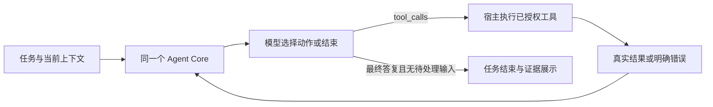

# Plan3 目标架构

2026-11-03 调整：整体 Agent 执行采用下文[统一自主执行方案](#13-统一自主-agent-执行方案2026-11-03-调整)。已有工具循环与新增的截图观察分开记录；[当前代码核对](#14-workflow-业务-agent-当前实现核对)不把待实现能力算作已交付。

## 1. 领域模型

Agent 节点是一个由 Agentx 原生 Agent Core 驱动的有状态智能体，不是 Model Node 与若干资源节点组成的隐藏子 Workflow，也不是调用远程 Pi Runtime 的代理节点。

```text
Workflow Node Attempt
  └─ Agent Core Run
      ├─ 内置且必选 Model
      ├─ Agent loop / Context / Compaction / Session
      ├─ optional Agent Workspace Sandbox
      ├─ conditional read / write / edit / bash
      ├─ 可选 MCP Tools
      ├─ 可选 Skills
      ├─ 可选 Knowledge
      └─ 可选 Long-term Memory
```

Workflow 主连接只传递 Node Input/Output Item。资源附件声明 Agent 可用能力，不推进 Scheduler，也不创建独立 Node Execution。

## 2. 参考实现与 Agentx 实现的关系

参考源为 [earendil-works/pi](https://github.com/earendil-works/pi) Commit `a69bef789bc95abf0acee16f7b4660b70b650bb9`。

| 参考 Pi 概念 | Agentx 目标实现 | 说明 |
|---|---|---|
| `Agent` / `agent-loop` | `agentx-agent-core` Run Driver | 保留消息、Turn、Tool loop、事件、steer/follow-up 行为 |
| `AgentMessage` | Agent Core Entry Payload | 支持 user/assistant/toolResult 及受控自定义消息 |
| `transformContext` / `convertToLlm` | Context Projector | 从完整历史构造当前模型可见 Context |
| Session Entry Tree | Runtime Agent Session Entries | 不使用 Pi JSONL/SQLite 格式；首期只启用 `main` Lane |
| Operation State | Runtime Agent Operation State | 完整状态作为恢复程序计数器，不靠日志反推 |
| Compaction | Agent Core Compaction | 阈值、overflow、Summary、retained tail 和 Usage 进入权威状态 |
| `read/write/edit/bash` | Optional Workspace Sandbox + Core Tool Definition | Agent 未选 Sandbox 时不注册，选择后经 OpenSandbox Adapter 执行 |
| Usage Ledger | Agentx Runtime Call/Usage Ledger | Token、成本、工具副作用仍由 Runtime 权威入账 |

不要求 Rust API、数据库 Schema 或事件名与参考仓库逐字相同；要求冻结的行为 Fixture、状态机不变量、故障恢复和用户可见语义一致。

## 3. 目标调用链

```text
Control Plane
  Workflow Draft / Resource Grant / Model / Skill / Memory / Knowledge
        │ publish
        ▼
Execution Spec Bundle 2.0
  Agent Definition + Core Profile + exact Resource Bindings
        │ prepare / activate
        ▼
Runtime Gateway / Workflow Runtime
  Invocation → Execution Snapshot → Agent Node Attempt
        │ queue / claim / lease
        ▼
workflow-worker (Rust, authority holder)
  ├─ Agent Runtime Adapter
  │    ├─ load/create Agent Session and complete Operation State
  │    ├─ construct agentx-agent-core
  │    └─ drive Run until terminal/suspend/cancel
  │
  ├─ agentx-agent-core (Rust library, no infrastructure client)
  │    ├─ message/context projection
  │    ├─ turn/tool loop and queues
  │    ├─ threshold/overflow compaction
  │    ├─ durable state transition requests
  │    └─ typed lifecycle events
  │
  └─ Runtime Adapters
       ├─ Model → Egress Gateway → Provider
       ├─ HTTP/SSE MCP → Egress Gateway → MCP
       ├─ stdio MCP → sandbox-manager Process Session
       ├─ Memory/Knowledge → governed adapters
       ├─ Skill → signed Runtime Object
       └─ read/write/edit/bash → sandbox-manager → OpenSandbox
        │
        ▼
Runtime MySQL + Runtime OSS + Trace Outbox
```

没有 `pi-agent-runtime` Service，没有 Rust↔TypeScript gRPC，也没有第八构建产物。

## 4. 模块职责

### 4.1 platform-control

- 管理 Model、MCP、Skill、Memory、Knowledge、Sandbox Profile 和 Grant。
- Compiler 校验 Agent 必选 Model、可选 Workspace Sandbox、Session Policy、四工具可用性和外挂能力闭包。
- Publisher 固化 Agent Core Contract Version、参考行为版本、Model Revision、Sandbox Profile、资源闭包和授权证据。
- 不执行生产 Workflow 的 Agent loop，不保存业务运行消息或 Compaction。工作流与网页创作由 Control 的设计态 Host 驱动同一个 Core，状态保存在设计态域，详见 [plan9 共用设计态 Agent](../plan9/06-shared-design-agent.md)；不能把这条创作路径混入业务运行面。

### 4.2 workflow-runtime

- 创建 Execution/Attempt、调度、Claim、Lease、Fencing 和恢复。
- 管理 Agent Session、Entry、Operation State、Usage Reference、CAS 和 Retention。
- 将 Agent Workspace Checkpoint 与 Execution/Fork/Retention 关联。
- 不实现 Agent loop 的消息和工具决策。

### 4.3 workflow-worker Agent Runtime Adapter

- 从冻结 Bundle 和 Execution Snapshot 构造 `AgentRunInputV1`。
- 为 Agent Core 实现 Model、Tool Effect、State Store、Clock、Budget 和 Event Sink trait。
- 在外部副作用前提交 Intent，在结果可见后原子提交 Settlement、Usage 和下一完整 Operation State。
- 验证 Attempt Lease/Fencing、Deadline、稳定 Action ID、预算和 Grant/Policy Epoch。
- 把 Core Event 映射到 Agent Run/Turn/Tool/Compaction Trace 和应用流式输出。

### 4.4 `agentx-agent-core`

- 独立 Rust crate，禁止依赖 SQLx、Redis、OSS SDK、Vault、Reqwest、Kubernetes Client 和宿主文件 API。
- 维护 AgentMessage、Context Projection、Turn/Tool loop、steering/follow-up、Compaction 和 Operation State Transition。
- 只通过 trait 请求 Model/Tool/State Effect；不持有 Provider Credential、数据库连接或 Sandbox Endpoint。
- 其状态必须完全可序列化、可校验、可恢复；不可逆效果不能只存在于 Future/闭包/进程内变量。
- 首期只启用一个 `main` Lane；多 Lane、导航、分支和子 Agent 不进入本计划。

### 4.5 sandbox-manager

- 继续作为 OpenSandbox Credential、Endpoint、Lease 和 TTL 的唯一管理者。
- 为 Core `read/write/edit/bash` 提供稳定的文件、Patch 和 Command Adapter。
- 为 stdio MCP 提供受 Lease/Fencing 管理的长驻 Process Session：start、stdin write、stdout frame、stderr diagnostics、wait、interrupt、terminate 和 reconcile。
- 不感知 Agent Prompt、Model 或会话消息。

## 5. Agent 内部 Model

Agent Inspector 使用统一 Resource Picker 选择一个 `model/use` Reference。引用继续参加可见性、Workflow Service Identity Grant、发布冻结、撤权、价格、Token 和 Trace。

Model Reference 不带 Editor `bindingId`，因此不会物化为 Attachment Node 或 Binding Edge。独立 Model Node 继续表示一次模型调用，不能连接到 Agent。

Agent Core 只接收冻结的 `ModelDescriptor` 和 `ModelEffect` trait；Provider 格式转换、Credential、Egress、重试计费和 Runtime Call Ledger 留在 Worker Adapter。

## 6. Agent Core 状态模型

参考 Pi Harness 的三类权威数据，在 Agentx Runtime 中实现为：

```text
Agent Session Entries     append-only：message / tool_result / compaction / custom
Agent Session Registers   mutable：lane state / operation meta / complete operation state
Usage Ledger              append-only：model / compaction / external tool usage
```

核心不变量：

1. Entry 和 Usage 写入后不可修改；Compaction 改变模型投影，不删除完整历史。
2. `operation_state` 是完整程序计数器，恢复不扫描历史猜测下一步。
3. 一个持久 Session + Agent Node 同时最多一个开放 Operation。
4. 每个 Provider/Tool 外部效果采用 `intent commit → effect → settlement commit`。
5. Intent 已提交但 Settlement 未提交时，按照显式 Replay Policy 处理：安全读可重放，不安全写产生稳定 Unknown/Interrupted Tool Result，禁止盲目重复。
6. Terminal Transaction 原子写最终结果、清理开放 Operation Register 并释放 Session Busy。
7. Core State Transition 与 Attempt Lease/Fencing 绑定；失去 Lease 的 Worker 不能提交任何 Settlement。

## 7. 可选 Agent Workspace Sandbox 与内置工具

### 7.1 工具契约

| Tool | 参考语义 | Agentx 执行 | Replay / Execution |
|---|---|---|---|
| read | 相对路径、范围读取、文本/图片与截断 | OpenSandbox File Adapter | safe / parallel |
| write | 完整内容写入、父目录与结果摘要 | OpenSandbox File Adapter | never / sequential |
| edit | 精确替换、冲突、Diff 摘要 | OpenSandbox Patch Adapter | never / sequential |
| bash | command、cwd、timeout、流式 stdout/stderr | OpenSandbox Command Adapter | never / sequential |

Schema、错误、截断阈值和结果呈现由 `CoreToolContractV1` 冻结，并通过对参考 Commit 的差分 Fixture 验证。Agentx 可以增加安全限制，但不得悄悄改变模型看到的成功/失败语义。

所有路径相对于 Agent Workspace Root。拒绝绝对路径、`..`、软/硬链接越界、设备文件、挂载逃逸和跨 Workspace Handle。

Agent Workspace Sandbox Reference 的基数为 `0..1`：

- 未选择：Core Tool Registry 中不存在 `read/write/edit/bash`，System Prompt 也不描述这些能力；模型伪造同名调用返回未注册 Tool，不触发任何 Sandbox 创建。
- 已选择：Publisher 固化精确 Sandbox Profile Version，Runtime 获取独立 Lease 后注册四工具。
- stdio MCP 自己携带的 Runtime Sandbox 不满足这项条件，不能间接开启 Agent 四工具。

### 7.2 Workspace 生命周期

- `invocation`：Attempt-scoped Workspace，Run 结束后按 Retention 回收。
- `application_session`：Session + stable Agent Node scoped Workspace，按 TTL 复用并通过 Checkpoint 恢复。
- 同一 Agent Session 同时只允许一个可写 Run；并发输入排队或返回 `AGENT_SESSION_BUSY`。
- 取消、超时和 Lease 丢失停止 Core 驱动、撤销 Handle，并终止或释放 Sandbox Lease。

### 7.3 两类 Sandbox 不共享

| Sandbox | 配置所有者 | 基数 | 用途 | Runtime Scope |
|---|---|---:|---|---|
| Agent Workspace Sandbox | Agent Definition Inspector | 0..1 | 四个内置工具 | Attempt 或 Agent Session |
| MCP Runtime Sandbox | stdio MCP Server Version | 1 | MCP 长驻进程及其私有文件 | Agent Run + MCP Server Version |

两者有不同的 Resource Reference、Grant、Profile Version、Lease、Workspace、Credential 和网络策略。Publisher 可以把两者同时放进同一 Bundle，但 Runtime 不合并权限、不共用目录，也不因其中一方存在而推断另一方存在。

## 8. 外挂能力映射

### 8.1 MCP Tool

- 每个 Binding 映射为一个 `AgentTool`，名称使用发布时 `tool_name_snapshot`。
- Tool 明确声明 input schema、side effect、replay 和 sequential/parallel；不再只选择首个 MCP。
- 名称冲突在发布时失败，运行时不重命名。
- Streamable HTTP/SSE 继续通过受控 Egress 调用，不要求 Sandbox。
- stdio MCP Server Version 创建时必须选择一个 Runtime Sandbox Profile；自动发现的 Tool Version 继承 Server/Sandbox 版本，不逐 Tool 重复配置。
- 同一 Agent Run 中来自同一 stdio Server Version 的多个 Tool 共用一个 MCP Process Session；进程只解析 stdout JSON-RPC，stderr 作为受限诊断流。
- Agent 没有 Workspace Sandbox 仍可调用 stdio MCP，因为 MCP 使用自己的 Sandbox；反过来，MCP Sandbox 不开放 Agent 四工具。

### 8.2 Skill

- Skill Version、入口 `SKILL.md`、资产和递归依赖全部来自签名 Bundle。
- 参考 Pi 的 Skill Prompt/Resource 组合语义，但禁止从用户目录、项目目录或 npm/git 动态发现。
- Skill 依赖的 MCP/Model/Credential/Knowledge/Memory 逐项保留 Grant。

### 8.3 Knowledge

- 每个 Binding 注册稳定的检索工具；由 Agent 自主调用，不在每轮无条件注入全部结果。
- Query、Top K、Citation、耗时和错误进入 Ledger/Trace。
- 检索结果作为不可信数据，不能覆盖 System Prompt 或工具授权。

### 8.4 Long-term Memory

- Recall 可在当前 User Message 前作为带来源的 Context Entry 注入。
- 写入、更新和删除通过受权 Tool 或明确后台策略完成，不自动保存全部 Transcript。
- Memory 使用授权同时允许读写；内容不是 System Instruction。

## 9. Session、Context 与 Compaction

### 9.1 两类上下文

- **Run 内上下文**：Agent loop 必需，始终存在，包含本 Run 的 user/assistant/toolResult。
- **跨 Execution 短期上下文**：由 `sessionPolicy.mode=application_session|invocation` 显式决定。

Studio 可以显示“跨执行保留上下文”开关，但 Definition/Bundle 必须保存枚举。用户身份不参与短期 Session Key，所以同一用户再次执行不会自动加载短期历史。

### 9.2 持久 Session Key

```text
tenant_id
+ application_deployment_id
+ application_session_id
+ workflow_id
+ stable_agent_node_key
```

`application_session` 缺少可信 Application Session ID 时明确失败；`invocation` 创建临时 Session，并且下一次 Execution 不读取它。

### 9.3 Context Projection

Agent Core 从当前 Lane 的完整 Entry 链生成模型 Context：

1. 找到最新有效 Compaction Entry。
2. 投影 Summary + retained tail + 之后的 user/assistant/toolResult。
3. 注入受权的外部 Context Entry，但过滤 UI/Trace-only 自定义消息。
4. 将当前 User Message 追加一次，避免 Application Message 与 Invocation 输入重复。
5. 依据模型能力转换为 Provider-neutral Message，再由 Model Adapter 转换 Provider 格式。

### 9.4 Compaction

- 自动压缩属于 Agent Core，始终开启；不提供关闭开关。
- 仿照参考实现冻结 threshold 与 overflow 两条路径、`reserveTokens`、`keepRecentTokens`、结构化 Summary 和 retained tail。
- Compaction 模型调用走同一个 Agentx Model Adapter，产生独立 Runtime Call、Usage、成本和 Trace。
- Compaction Entry 追加到完整历史；旧 Entry 不删除，下次 Context Projection 从最新 Compaction 开始。
- 压缩准备、模型请求 Intent、Usage、结果和下一 Operation State 都可恢复。

## 10. 长期记忆身份

当前身份和作用域以 [应用用户与记忆连接](../plan8/10-application-user-memory.md) 为准。用户身份来自平台登录、渠道验签后的发送者或应用部署指定的 API 输入参数。API 参数为直接声明，不验证其账号、真实性或归属，来源与平台操作人分开存储。无身份时个人长期记忆不可用，不退化为共享范围。

记忆键包含租户、环境、应用、工作流、稳定节点和来源用户；不包含发布版本、部署 ID、API Key 或会话 ID。Studio 使用独立调试域。

## 11. 故障与恢复

| 故障/边界 | 目标行为 |
|---|---|
| Worker 在模型请求前强退 | Intent 未提交则不调用；已提交则按 Runtime Call 状态决定重试或 Unknown |
| Worker 在 Tool Effect 中强退 | `safe` 可按持久参数重放；`never` 生成 Interrupted/Unknown Tool Result 后继续或失败 |
| Worker 在 Settlement 后强退 | 新 Worker 从完整 Operation State 继续，不重复已结算效果 |
| Sandbox 强退 | Reaper 清理；Workspace 从 Checkpoint 恢复或明确失败 |
| MySQL 不可用 | 不提交 Intent/Settlement/State，停止推进 |
| Runtime OSS 不可用 | 不提交依赖 Object Reference 的新状态 |
| Redis 丢失 | 从 MySQL Attempt/Outbox 重建，不丢 Session Entry/Operation State |
| ClickHouse 不可用 | Trace 延迟补投，不改变 Agent 结果 |
| Control 全离线 | 已激活 Bundle 继续执行，Worker 不回读 Control |

## 12. 部署与容量

- 构建产物仍维持现有七类；`agentx-agent-core` 是 Rust Library，不新增 Deployment/Service。
- Workflow Worker 镜像不增加 Node.js、npm lockfile 或 Pi CLI。
- Worker 继续使用现有 ServiceAccount、NetworkPolicy、PDB 和滚动发布边界。
- 新增容量指标：开放 Agent Operation、Context Token、Compaction、Model/Tool effect pending、Session Busy、Core 驱动时长和 State 大小。
- Worker `2→4→2`、Drain、PDB 和滚动升级必须证明没有进程内 Session 粘性；任一新 Worker 可从 Runtime 权威状态恢复。
- Core crate 依赖边界由 Cargo/static check 固定，禁止未来偷偷引入基础设施客户端。

## 13. 统一自主 Agent 执行方案（2026-11-03 调整）

本节记录已确定的执行方向，适用于 Workflow 业务 Agent、Workflow 创作 Agent 和业务界面创作 Agent。现有循环继续使用；外层两类创作的截图、多模态工具结果、浏览器观察与位置编辑已接通，实施边界与验收状态见[浏览器创作实现](02-design-browser-agent.md)。下文代码核对保留方案制定时的基线事实。

### 13.1 一套 Core，宿主提供任务与工具

| 场景 | Host 与任务来源 | 模型及工具来源 |
| --- | --- | --- |
| Workflow 业务 Agent | Runtime Worker 内的 Agent Node Attempt | 签名 Bundle 中冻结的节点 Model、systemPrompt、输入和已授权附件 |
| Workflow 创作 | Control 共用设计态 Host，目标为当前 Workflow/Draft/Editor Binding | 平台 AI 模型，工作流编辑、契约、校验与布局工具 |
| 业务界面创作 | 同一设计态 Host，目标为应用页面草稿及其绑定契约 | 同一平台 AI 模型，页面读取、编辑、SDK、检查与预览工具 |

三者复用 `agentx-agent-core` 的消息、工具循环、压缩、预算 Port 与 Pending/Resume；不新增第二套 loop、远程 Pi/Codex 运行时或用户可配置 Agent 工厂。业务节点使用节点模型，设计态使用平台模型，两者不能因共享 Core 而混用模型或权限。

这里的 Harness 指围绕 Core 的上下文、工具、持久状态、费用、事件及执行环境。Core 的现有入口仍为 `AgentCore::run`；Codex 的 `run_turn` 是参考行为，不要求照搬函数名称或替换当前内核。

### 13.2 模型自主决定动作

一次用户任务或一次 Agent 节点执行可以包含多次上游模型请求。单次 HTTP 模型请求与完整 Agent Run 是两个层次，不把多轮模型调用包装成一次供应商计费请求。



- 模型通过标准 `tool_calls` 选择读取、编辑、检查、浏览器操作和再次修复，平台不编排固定的生成顺序、截图次数或修复步骤。
- ReAct 采用行动与观察循环，不解析模型正文中的自定义 `Thought/Action` 标记，不要求模型输出完整思考过程。
- 领域 Prompt 说明目标、权威契约、工具用法、质量要求和停止条件；检查或编辑失败应在同一 Run 内成为下一轮的观察，日常纠错不依赖用户反复发送“继续修改”。
- 可确定且可纠正的参数、匹配、语法和预览错误应返回模型可见诊断；确定未执行时由模型决定重新读取或修改。当前部分参数解析分支直接终止，需要在实施时逐项核对，不能宣称所有错误已可自动修复。
- 取消、费用/时长/调用上限、Lease 失效、明确授权拒绝和不可安全重放的未知效果继续遵循既有终止或挂起语义，不通过循环自动扩大权限、重置预算或重放业务写入。

Workflow 外层继续按冻结图调度节点、分支、Loop、Wait 与 Approval；Agent 只自主选择自身 Registry 内的工具。业务 Agent 不因自主执行而取得修改当前运行图或应用页面的设计权限。

### 13.3 平台保留执行语义，不代替模型编排任务

平台负责租户和对象授权、工具 Schema、草稿版本/hash、原子编辑、ACK/保存、正式发布权限、租约、副作用与用量账本。这些是每次工具操作的正确性边界，不是额外的一套 AI 业务流程。

布局工具只改变其声明范围内的位置与尺寸；Workflow 编辑工具仍可在用户授权的范围内修改业务图。不能借“美化”改变参数、条件、端口映射或连接，也不能用任意浏览器拖拽绕过原编辑事务。

模型可以自主安排检查与决定结束，不增加要求每种任务逐项执行固定步骤的完成门禁。任务运行状态与质量证据分别展示：Run 已结束不等于检查通过；未检查、通过、失败和过期都来自真实报告。页面或画布改动后，旧版本报告不能继续代表当前版本通过。现有保存与发布合法性校验继续生效，Prompt 不能替代这些校验。

### 13.4 标准图片输入与多模态观察

复用现有模型 `vision` 能力声明。截图观察要求所选模型真实支持图像输入和工具调用；能力与模型版本一起冻结。未声明或不支持时，截图观察功能明确不可用，不用文本 base64 假装看图，也不自动更换模型。原有文本创作能力继续按其自身能力运行。

当前 Provider 路径使用 OpenAI-compatible Chat Completions，图片仅以标准 `image_url.url = data:image/webp;base64,...` 输入；不新增私有图片参数、不依赖外部图片 URL。`detail` 仅在接入模型明确支持时按标准字段发送。

Chat Completions 的 `role=tool` 只携带文本。宿主应先补齐模型本轮所有 `tool_call_id` 的文本回执，再自动加入标准 `role=user` 多模态观察消息携带图片。这是工具产生的观察，不是新的用户需求、Session 或 Run；其来源、Effect、当前文档 hash 和合成消息 ID 需要可恢复、可去重。页面内容和图中文字仍是观察数据，不能变成系统指令。

Core 工具结果协议需要能表达文字与图片引用；Runtime 与设计态共用相同的模型投影，不能只改创作 UI。持久历史保存受授权的图片引用、hash、尺寸和来源，发送模型时解析成 base64；完整 base64 不进入普通工具日志、Trace 或压缩摘要。不能把已生成 Artifact 链接等同于图片已经进入模型上下文。

初始截图规格如下，属于待实测的质量与体积目标，不是已经验证的固定最优值：

| 项目 | 方案 |
| --- | --- |
| 格式 | WebP，实际模型需支持这一图像格式 |
| 质量 | 80～85 作为起点，以文字、端口和连线清晰度验收 |
| 视口倍率 | 1 倍，避免不必要的高 DPI 截图 |
| 普通图片 | 最长边约 1440 像素，目标约 200～500 KB，不为字节目标牺牲可读性 |
| 大页面/工作流 | 总览用于结构，按需补局部截图；不将全图压缩到文字无法辨认 |
| 工具结果 | 同时保留 DOM/节点 ID、几何信息和错误摘要，减少仅靠截图猜测 |

图片传输压缩与模型图像 Token 成本分别处理；不能把 base64 当普通文本估算，也不能因为图片文件较小就假定费用很低。继续使用原 Usage/预算账本；图片历史、压缩和恢复均需保持来源授权与用量可解释。

### 13.5 浏览器执行和两类创作

浏览器由现有 Sandbox Manager 管理 OpenSandbox 资源，复用已有 Playwright 能力。Core 不连接浏览器或 Kubernetes；Control 只编排有范围的检查请求，模型与凭据、账本、状态仍在原可信宿主。设计预览使用受限浏览器执行资源，不因此给网页 Agent 注册任意 Workspace `bash` 或生产工具。

- 网页创作使用同一页面、SDK、样式与场景契约，提供观察、输入、点击、文件夹具、刷新、控制台和检查结果。模型自主检查轮询、导出和历史恢复后的真实可见内容；浏览器操作不成为另一条保存/发布链路。
- Workflow 创作使用实际画布组件、节点 Manifest、端口与草稿快照，返回全图/局部截图和几何事实。AI 选择布局策略，复用 ELK 与原编辑事务计算/应用位置；需要局部整理时明确补充局部布局范围，不以当前全图 `auto_layout` 冒充局部支持。
- Workflow 业务 Agent 仅使用发布时授权的工具与执行环境。已有 Browser Command 或外部浏览器 MCP 不等于已具备创作画布观察能力；业务浏览器能力也不自动授予其他节点或设计态 Profile。
- 预览、模拟交互和真实业务测试分别记录来源。真实工作流、外部副作用及审批继续使用既有运行身份、授权和测试入口；界面检查通过不能替代业务运行证据。

### 13.6 与 Codex 参考实现的关系

2026-11-03 读取官方 `openai/codex`，固定 Commit `dbaead0106de82bd129a4f6f503d173ad5109f68`。参考其工具结果持续反馈、图片进入多模态消息、工具执行与宿主分工；不把公开 CLI 的通用循环等同于桌面产品全部浏览器能力。Codex 有 Stop hook 续跑机制，但本方案不复制一个通用 Hook 管理系统，也不写死网页或 Workflow 的执行流水线。

参考：

- [Codex 工具循环](https://github.com/openai/codex/blob/dbaead0106de82bd129a4f6f503d173ad5109f68/codex-rs/core/src/session/turn.rs#L163-L178)。
- [Codex 图片结果](https://github.com/openai/codex/blob/dbaead0106de82bd129a4f6f503d173ad5109f68/codex-rs/core/src/tools/handlers/view_image.rs#L238-L254)。
- [OpenAI 标准图像输入](https://developers.openai.com/api/docs/guides/images-vision)和 [Chat Completions 消息](https://developers.openai.com/api/reference/resources/chat/subresources/completions/methods/create)：tool 回执为文本，图片观察使用标准多模态消息。

## 14. Workflow 业务 Agent 当前实现核对

核对基于 2026-11-03 工作树，属于源码事实审计；本次没有新增真实模型请求或重跑 Kubernetes 验收。

| 问题 | 当前事实与源码 |
| --- | --- |
| 是否一次节点执行可有多次模型请求 | 是。[Worker](../../src/services/agentx-v2-runtime/src/worker_runtime.rs) 进入业务适配器，构造 `AgentRunInputV1` 后直接调用同一个 `AgentCore::run`，见 [业务入口](../../src/services/agentx-v2-runtime/src/worker_runtime_agent_core.rs) |
| 工具顺序由谁决定 | 模型返回 `tool_calls`；[Core Driver](../../src/crates/agentx-agent-core/src/driver.rs) 执行后追加带 call ID 的结果并 `continue` 再请求模型，不是每次调用都等待用户继续 |
| Prompt 和模型来自哪里 | 业务入口读取节点 `systemPrompt`、`userQuestion` 或上游输入，Model 来自精确冻结绑定；[ModelPort](../../src/services/agentx-v2-runtime/src/worker_runtime_agent_model.rs) 每轮复查附件授权并发送请求 |
| 能调用哪些工具 | [附件 Registry](../../src/services/agentx-v2-runtime/src/worker_runtime_agent_attachments.rs) 提供 MCP/Skill/Knowledge/Memory 能力；选定 Workspace 才注册四工具。资源附件不等于画布执行步骤 |
| 是否必须有跨执行会话才能循环 | 否。`invocation` 模式同一次 Run 内照样保留多轮消息；`application_session` 决定后续 Execution 是否复用可信会话，不决定本次是否可多轮 |
| 是否有持久恢复和限制 | 有。[StatePort](../../src/services/agentx-v2-runtime/src/worker_runtime_agent_state.rs) 保存状态，[WorkerBudget](../../src/services/agentx-v2-runtime/src/worker_runtime_agent_budget.rs) 检查取消、截止、Token、费用和调用限制，未知写入不盲重放 |
| 是否允许任意长任务 | 否。当前 `effective_agent_budget` 将 `maxIterations`、`maxModelCalls` 默认设为 12，且二者都截断在 1～12；这是业务节点当前实现上限，不是一次用户需求只能请求一次，也不等于完整验收账本的 190 次 |
| 截图是否自动进入模型 | 尚未贯通。工具结果 `content` 是字符串，Driver 把它转成文本消息；MCP/Sandbox Artifact 引用不会自动变成图像输入。`ModelContentV1` 已有多模态类型，不能据此宣称工具截图链路已完成 |
| OpenAI 消息如何发送 | 两个 Host 复用 [agent_model_protocol](../../src/services/agentx-v2-runtime/src/agent_model_protocol.rs)；现有序列化不会把文本工具结果自动变成截图观察消息 |
| 所有错误能否自主修复 | 不能保证。普通确定工具失败可回传 `is_error`，但部分 Core 参数校验及 Provider tool-call JSON 解析会直接结束，需要按第 13.2 节补齐可纠正错误反馈 |
| 结束是否等于验收通过 | 否。无工具调用且无待处理输入时，Core 可返回 Completed；设计态 Host 会映射为 completed，业务态由节点输出结束执行。它不证明已经看过截图、执行所有检查或完成真实业务验收 |

因此，当前 Workflow 业务 Agent 已是有状态、带工具的自主 Harness；截图视觉与浏览器检查闭环尚不完整。Workflow 创作 Agent 是使用同一 Core 的另一种 Host/Profile，二者工具、模型来源和目标权限保持分离。

## 15. 本次方案调整的实施与验收边界

以下外层创作能力已实施并通过临时环境验收，完整边界、请求用量和证据见 [浏览器观察与视觉编辑实现](02-design-browser-agent.md#验收与费用)：

| 顺序 | 已实施内容 | 验证重点 |
| --- | --- | --- |
| 1 | 统一多模态工具结果、标准 Chat 投影、vision 能力与图片预算 | 两个 Host 共用；完整 call ID 回执、图片消息顺序、来源和恢复去重；不支持图片时明确不可用 |
| 2 | 复用 Sandbox Manager/Playwright 的受限浏览器观察与操作 | 使用实际渲染组件；会话/草稿隔离、授权 Artifact、取消与资源清理；不新增伪业务 Invocation |
| 3 | 更新领域 Prompt、可修复错误反馈、真实报告展示及布局作用域 | 模型自主选择步骤；Run 结束与检查结果分开；单次工具事务仍受原正确性约束 |
| 4 | 自主完成率和原能力回归 | 用户一次需求后不再由测试脚本注入定点修复提示；统计请求数、费用、自动完成率及人工介入；保留首个失败证据 |

系统验收继续以 Python `pytest tests/e2e` 编排临时环境，浏览器业务使用现有 TypeScript Playwright。覆盖 Workflow 原工具多轮调用、授权、会话、审批、恢复，以及新截图、网页交互和画布布局；真实模型采用显式配置和另行明确的有限预算，沿用实际账本，不复用旧验收结果宣称新增能力通过。
